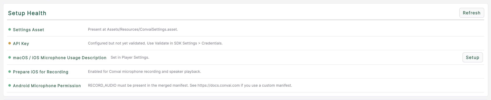

Open **Convai > Settings** or **Edit > Project Settings > Convai SDK** to edit project-wide SDK settings. Both commands open the same Project Settings panel. Edit character, room, and input settings on their scene components or prefabs.

## Settings sections

| Section | Purpose | Important controls |
| --- | --- | --- |
| Setup Health | Check project configuration and platform prerequisites. | Settings asset, credentials, microphone descriptions, iOS recording setup and Android permissions. |
| Credentials | Select authentication and service configuration. | Auth Mode, API Key, token endpoint fields, Environment and Character Workspace ID. |
| Runtime Defaults | Seed runtime preferences. | Transcript System, Notification System, Player Display Name, Microphone and Background Policy. |
| Diagnostics | Control SDK logging. | Verbose, Default, Errors Only, Global Log Level, Stack Trace Levels, Colored Console Output and category overrides. |
| Advanced | Support-directed timeout and optional build features. | Connection Timeout (s) and Feature Flags for the active build target group. |
| About | Inspect installed SDK information. | Package and version information. |

<figure><figcaption>
Setup Health reports local configuration; validate the actual connection separately.
</figcaption></figure>

## Credentials and service selection

**Api Key** is the rendered enum label for API-key authentication. **Auth Token** exposes **Token Endpoint URL**, **HTTP Method**, **Token Response Field** and **Request Headers**. Use [Configure API key](configure-api-key.md) for local development and [Authentication](../authentication/README.md) for production token setup.

**Environment** selects the service environment. **Custom** exposes Core Server URL, REST API and Character API overrides. Change these only for an environment you intend to target. **Character Workspace ID** supplies the optional workspace for Character and Narrative reads. [REST API routing](../advanced-topics/choose-a-rest-api-mode.md) describes how each service selects its host.

Changing credentials or endpoints does not rotate authentication inside an established room. Reconnect to use new connection credentials.

## Runtime defaults

| Setting | Default | Scope |
| --- | --- | --- |
| Transcript System | On | Enables transcript presentation by default; runtime preferences can override it. |
| Notification System | Off | Enables session-state and error notifications. |
| Player Display Name | Player | Default display name, distinct from local Player ID and end-user identity. |
| Microphone | System Default | Default device choice; **Refresh** enumerates connected devices again. |
| Background Policy | PauseTimeline | How local presentation behaves when the application is backgrounded. |

These values initialize the runtime settings service. A runtime settings UI or script can override them. For effective character volume, use [Configure character audio](configure-character-audio.md); for capture policy, use the room's **Allow Microphone** setting.

## Diagnostics and advanced settings

Logging presets replace category overrides. Use a narrow log level when investigating a problem, and review logs for sensitive values before sharing them.

**Connection Timeout (s)** has a UI range of 5–120 seconds and a default of 30. It is not a replacement for every transport-specific timeout. Feature flags modify scripting define symbols for the active build target group and trigger script recompilation; the Editor asks for confirmation before applying them.

Each section's reset applies to that section. The Advanced reset also disables Convai feature flags for the active build target group. Review the confirmation dialog before resetting.
