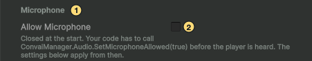

Turn off **Allow Microphone** to connect without opening or publishing a local microphone. Typed messages still work in ordinary single-character and multi-character sessions. Character voice playback is a separate choice.

## Configure text input



### Disable microphone access

On `ConvaiRoomManager`, expand **Listening > Microphone** and turn off **Allow Microphone**.

<figure><figcaption>
(1) Find the <strong>Microphone</strong> group in <strong>Listening</strong>. (2) Clear <strong>Allow Microphone</strong> before connecting.
</figcaption></figure>

This policy is stronger than muting: it prevents the SDK from opening the microphone. Muting an allowed microphone can leave its capture device active.




### Choose whether replies are audible

For text input with spoken replies, leave **Convai Character > Audio > Play Voice On Start** enabled. For a silent conversation, turn it off on each character. At runtime, use `manager.Audio.SetRemoteAudioEnabled(character.CharacterId, false)` to disable that character's voice playback.



### Add and verify typed input

Follow [Add chat UI](add-chat-ui.md). Connect and wait until the input prompt indicates the addressed character is ready. Type a message and confirm a reply appears in the transcript.

For your own UI, call `ConvaiPlayer.TrySendTextMessage(message, out reason)`. A `false` result includes a refusal reason, such as no ready character. A `true` result means the local send path accepted the message; it does not guarantee a server reply.




Group conversation accepts player speech through push-to-talk and refuses typed player messages. Use an ordinary room for this workflow. Disabling the microphone does not add text support to a group room.


## Allow voice during a session

After the player chooses to use voice, call `manager.Audio.SetMicrophoneAllowed(true)` on the initialized `ConvaiManager`. The SDK starts the microphone according to the current input mode once the character can hear it. This can trigger a platform permission prompt. Browser playback may separately need a user gesture.

Call `SetMicrophoneAllowed(false)` to stop listening, unpublish the microphone and end a held press without reconnecting. `StartListeningAsync()` then fails with `audio.mic_not_allowed`, and push-to-talk presses are refused. Read `IsMicrophoneAllowed` and subscribe to `manager.Audio.OnMicrophoneAllowedChanged` to update your UI.

The runtime choice applies to the current session, or the next session if none exists. It is cleared when that session ends, including a dropped connection or a failure after options were resolved. Configure **Allow Microphone** off in the room component or prefab for a persistent default, or apply an explicit policy to every connection your application starts.
