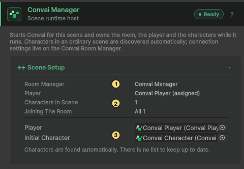
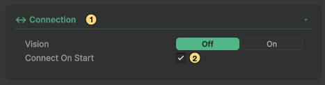
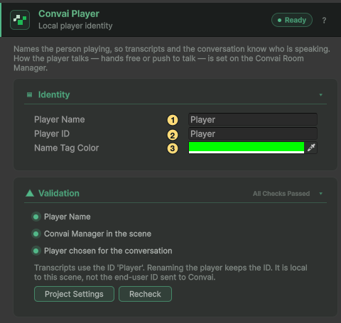

A conversation scene needs one `ConvaiManager`, a player, and at least one character with a Character ID. The room manager belongs on the same GameObject as the manager. Run **GameObject > Convai > Add Required Components** to create that pair, then add the player and characters.

## Manager and room

| Component | What to configure |
| --- | --- |
| `ConvaiManager` | Assign **Player** when the scene contains several `ConvaiPlayer` components. Use **Initial Character** when the room should start with a specific character. Scripts use this manager for connection, audio, events, and transcripts. |
| `ConvaiRoomManager` | Set **Connect On Start** under **Connection**, choose how the player talks, and configure microphone access, interruptions, and vision. If the manager starts without a room component on its own GameObject, it adds one with default settings. |

<figure><figcaption>
(1) <strong>Room Manager</strong> identifies the component that holds connection and input settings. (2) <strong>Characters In Scene</strong> and <strong>Joining The Room</strong> show that the sample has one character and that it joins the room. (3) <strong>Player</strong> and <strong>Initial Character</strong> show the assigned scene objects.
</figcaption></figure>

<figure><figcaption>
(1) Open <strong>Connection</strong> on the <strong>Convai Room Manager</strong>. (2) Enable <strong>Connect On Start</strong> to connect automatically when the scene starts.
</figcaption></figure>

Edit room settings on the component. To share a setup across scenes, make the manager GameObject a prefab. See [Configure conversation input mode](configure-conversation-input-mode.md).

## Player and characters

| Component | What to configure |
| --- | --- |
| `ConvaiPlayer` | Place it on the player's GameObject. Its display name appears in conversation UI. Its stable local ID is distinct from the end-user ID used for memory. Use `TrySendTextMessage` to submit text and inspect a local refusal. |
| `ConvaiCharacter` | Add one per character. Set **Character ID** under **Identity**. Configure its version, audio, session resume, and memory on the component. Save a character prefab to reuse the configuration. |
| `ConvaiAudioOutput` | Add to a speaking character for per-character mute, volume, and distance controls. It requires `ConvaiCharacter` and `AudioSource`. Keep the voice AudioSource separate from sound effects. |

<figure><figcaption>
(1) <strong>Player Name</strong> is the display name. (2) <strong>Player ID</strong> is the stable local transcript identifier. (3) <strong>Name Tag Color</strong> sets the display color.
</figcaption></figure>

The manager discovers scene agents. A scene with several possible players needs an explicit assignment even if only one of them is active. Character availability and room membership can change during play. Use [Conversation availability](../features/conversation-availability/README.md) when deciding whether to enable player input.

## Verify the scene

Run **GameObject > Convai > Validate Scene Setup**, then connect and complete a turn. [Build a custom scene](build-a-custom-scene.md) walks through placement. [Migrate to SDK 5.0](../overview/migrate-to-5-0.md) covers older scenes that used a scene installer or configuration profiles.
