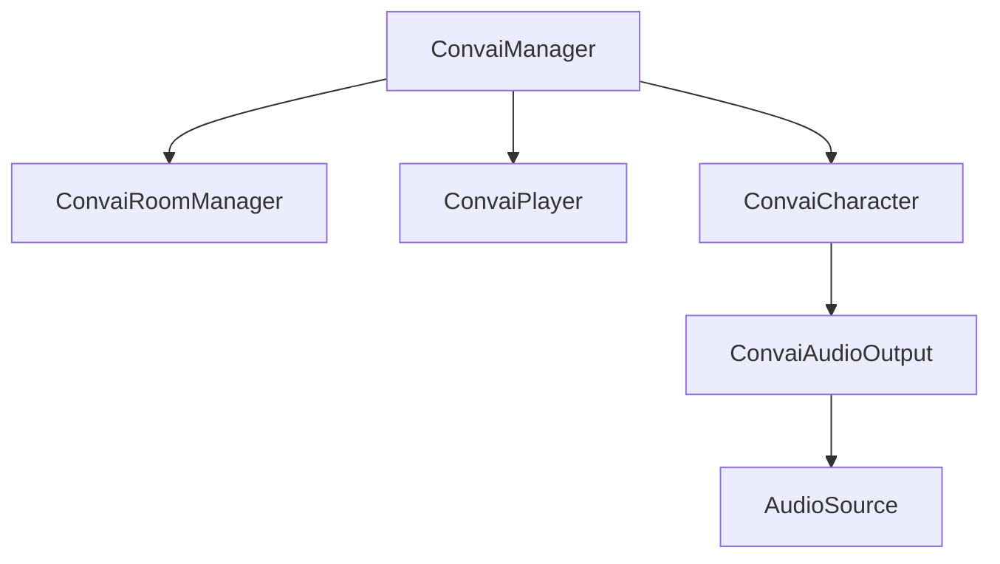
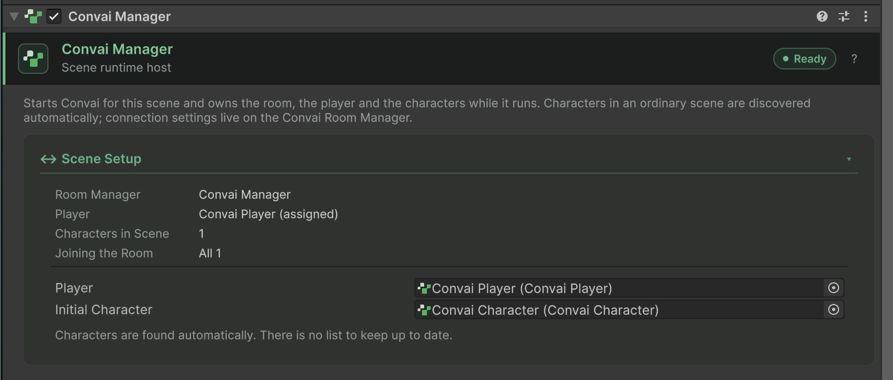

Every Convai-powered scene is built from four core components. Understanding what each one does and how they relate to each other makes building and debugging your setup straightforward.

## Component overview

The diagram below shows how the components depend on each other at runtime.



`ConvaiManager` is the root. It bootstraps the SDK, manages the room connection through `ConvaiRoomManager`, and owns references to all `ConvaiCharacter` and `ConvaiPlayer` instances in the scene.

## ConvaiManager

`ConvaiManager` is the SDK's entry point. It must be present in every scene that uses Convai. It initializes all internal services and injects dependencies into the other components automatically.

**Add it:** Use **GameObject > Convai > Setup Required Components** to create a `[Convai Manager]` GameObject with `ConvaiManager` and `ConvaiRoomManager`. Add the player and character separately as described in [Build a custom scene](build-a-custom-scene.md).

**Key behavior:**

* Singleton. Only one `ConvaiManager` may exist per scene.
* Runs at execution order `-1100` — it initializes before all other components.
* Auto-discovers `ConvaiCharacter` and `ConvaiPlayer` instances in the scene on startup.
* Injects dependencies into discovered components automatically when `_autoInject` is enabled (default: on).

**Useful properties at runtime:**

| Property                      | Type                             | Description                            |
| ----------------------------- | -------------------------------- | -------------------------------------- |
| `ConvaiManager.IsBootstrapped` (static) | `bool`                           | SDK internal services are initialized  |
| `IsInitialized`               | `bool`                           | Bootstrap complete and event hub ready |
| `IsConnected`                 | `bool`                           | Room connection is active              |
| `Characters`                  | `IReadOnlyList<ConvaiCharacter>` | All characters owned by this manager   |
| `Player`                      | `ConvaiPlayer`                   | The player component in this scene     |
| `ActiveConversationCharacter` | `ConvaiCharacter`                | Currently active conversation target   |

**Inspector sections:**

| Section | Controls and purpose |
| --- | --- |
| Scene Setup | Shows the Room Manager, Player, characters found and characters joining the room. Assign **Player** and **Initial Character** here. |
| Scene Setup, multiple characters | **Characters Joining the Room**, **Include Everyone** and **Include Nobody** choose the roster for the next connection. |
| Conversation Targeting | Appears when a room can hold several characters. **Chosen By** selects Look At, Proximity or Manual; **Player Camera** supplies the view. |
| Live, Play Mode | Shows connection, current target, input availability and the service-confirmed memory identity. |

<figure><figcaption><p>The single-character setup hides controls that only apply to larger rooms.</p></figcaption></figure>

See [Conversation targeting](../features/conversation-targeting/README.md) and [Multi-character sessions](../features/multi-character-sessions/README.md) for selection and roster behavior.

## ConvaiRoomManager

`ConvaiRoomManager` manages the connection lifecycle between your scene and Convai. It handles connecting, disconnecting, and reconnecting the audio session. It lives on the same GameObject as `ConvaiManager`.

**Key behavior:**

* Auto-connects on `Start()` when `ConnectOnStart` is `true` (default: `true`).
* Applies the same setting to character **Auto Connect**, including characters enabled later during play. When Room Setup Source reads a profile asset, the profile's **Connect On Start** value applies instead of the inline one.
* Reconnects automatically on transient failures, up to `_maxReconnectAttempts` (default: `3`).
* Manages microphone startup according to **Allow Microphone**, input mode and **Prepare Microphone**. The configured startup delay defaults to `0.5s`; it does not override a disabled microphone or browser permission requirements.

**Inspector fields:**

| Inspector label | Code field or property | Default | Purpose |
| --- | --- | --- | --- |
| Room Setup Source | `_configurationSource` | Inline | Read settings from this component or a reusable profile. |
| Room Manager Profile Asset | `_roomConfigAsset` | Empty | Settings asset used in Profile Asset mode. |
| Starts Connected | `ConnectOnStart` | `true` | Allows automatic room and character connections, including characters enabled later. Turn it off to connect from your own code. |
| Connection Type | `_connectionType` | Audio | Use Video when sending camera frames. |
| Push To Talk Key | `_pushToTalkKey` | `KeyCode.T` | Key used by built-in input. |
| Retry Attempts | `_maxReconnectAttempts` | `3` | Reconnect attempt limit. |
| Resume Conversation | `_resumePolicy` | ResumeIfPossible | Session resume policy. |
| Rejoin Window (s) | `_roomRejoinTtlSeconds` | `60` | Time window for rejoining an existing room. |
| Restart Character On Rejoin | `_spawnAgentOnRejoin` | `true` | Request character spawning when rejoining. |
| Startup Wait (ms) | `_startWaitTimeoutMs` | `5000` | Wait for component startup before connecting. |
| Mic Start Delay (s) | `_autoMicStartDelaySeconds` | `0.5` | Delay before eligible automatic microphone startup. |

**Conversation**, **Connection**, **Listening**, **Interruptions**, **Vision** and **Reconnect** organize these settings. Some advanced controls require developer settings to be enabled.

Turn-taking settings are also configured here. See [Configure conversation input mode](configure-conversation-input-mode.md).

## ConvaiCharacter

`ConvaiCharacter` represents one AI character in your scene. Each NPC or virtual instructor that talks to players needs its own `ConvaiCharacter` component. Multiple characters are fully supported: a scene with two or more eligible characters selected to join connects as one shared multi-character session, and a connection selecting exactly one character connects as a single-character session. See [Multi-character sessions](../features/multi-character-sessions/README.md) for how the room is built and how player input is routed to one character at a time.

**The Character ID field is required.** Get this value from your character's profile on the [Convai dashboard](https://convai.com).

**Inspector fields:**

| Inspector label | Code field | Default and purpose |
| --- | --- | --- |
| Character Setup Source | `_configurationSource` | Inline; choose Profile Asset for shared setup. |
| Character Profile Asset | `_characterConfigAsset` | Empty; supplies identity, audio and resume settings when selected. |
| Character ID | `_characterId` | Required dashboard character ID. |
| Character Version | `_characterVersionMode`, `_characterVersion` | Live; choose a released version to pin behavior. See [Pin a character version](pin-a-character-version.md). |
| Character Name | `_characterName` | Empty; display name. **Fetch** reads the dashboard name. |
| Name Tag Color | `_nameTagColor` | White; transcript label color. |
| Play Voice On Start | `_enableRemoteAudio` | On; enable voice playback. |
| Auto Connect | `_autoConnect` | Off; starts this character's conversation after initialization or re-enable while the room's **Starts Connected** (**Connect On Start** on a profile) is on. Explicit connection calls still work when **Starts Connected** is off. |
| Owner ID | `_ownerId` | Empty; use the local player. |
| Ready Timeout (s) | `_characterReadyTimeoutSeconds` | `30`; `0` waits indefinitely. |
| Resume Last Conversation | `_enableSessionResume` | Off; resume the supplied session when enabled. |
| Character Session ID | `_characterSessionId` | Empty; conversation to resume. |
| Opening Context > Initial Dynamic Info / Text | `_initialDynamicInfoKeepInContext`, `_initialDynamicInfoText` | Initial context for the connection. See [Static context](../features/dynamic-context/static-context-at-connection-time.md) for room-specific routing. |

**Auto Connect** acts only while the room's **Starts Connected** is on. With it off, no character starts a conversation automatically, including a character that is enabled or re-enabled later. `ConnectAsync` and `StartConversationAsync` calls are not affected. See [ConvaiRoomManager API](../scripting-reference/convairoommanager-api.md).

The **Memory** card controls character-level service settings separately from these local fields. See [Configure memory](../features/long-term-memory/configure-memory-for-a-character.md).

**Useful properties at runtime:**

| Property             | Type           | Description                                                   |
| -------------------- | -------------- | ------------------------------------------------------------- |
| `IsCharacterReady`   | `bool`         | Character has received the ready signal from Convai           |
| `IsSessionConnected` | `bool`         | Connected to the room (ready signal may not have arrived yet) |
| `IsInConversation`   | `bool`         | Connected and ready — true conversation state                 |
| `IsSpeaking`         | `bool`         | Character is currently outputting audio                       |
| `SessionState`       | `SessionState` | Full connection state enum                                    |

**Component dependencies:** `ConvaiAudioOutput` (handles audio playback for this character) must be on the same GameObject. `ConvaiAudioOutput` requires an `AudioSource` on the same GameObject.

## ConvaiPlayer

`ConvaiPlayer` identifies the user in the conversation. It provides the player's display name and color to the transcript UI and lets Convai attribute player speech to the correct participant.

**One `ConvaiPlayer` per scene.** Multiple player components in the same scene are not supported.

**Inspector fields:**

| Field           | Default    | Description                                                     |
| --------------- | ---------- | --------------------------------------------------------------- |
| `_playerName`   | `"Player"` | Display name shown in the transcript UI                         |
| `_playerId`     | _(empty)_  | Stable local identity for transcripts and character ownership; initialized once from Player Name when empty |
| `_nameTagColor` | Green      | Color used to identify the player in the transcript UI          |


`PlayerId` is local to the scene and is never sent to Convai. It remains unchanged when the display name changes. It is neither the end-user ID used for Long-Term Memory nor the server-assigned transcript speaker ID. Use `Configure(name, id)` when you intend to change the local ID.


**Useful methods:**

```csharp
// Override display name at runtime (for example, after a player logs in)
GetComponent<ConvaiPlayer>().SetRuntimeDisplayName("Dr. Reyes");

// Set both name and ID together
GetComponent<ConvaiPlayer>().Configure("Dr. Reyes", "user-123");
```

## Optional components

### ConvaiAudioOutput

Handles audio playback for a single character. Add it to the same GameObject as `ConvaiCharacter`. Requires an `AudioSource` on the same GameObject.

| Field          | Default | Description                        |
| -------------- | ------- | ---------------------------------- |
| `Volume`       | `1.0`   | Playback volume (0–1)              |
| `IsMuted`      | `false` | Mute this character's audio output |
| `_use3DAudio`  | `true`  | Enable spatial (3D) audio          |
| `_minDistance` | `5`     | Spatial audio minimum distance     |
| `_maxDistance` | `50`    | Spatial audio maximum distance     |

### ConvaiSceneConfig

A data asset created through **Assets > Create > Convai > Scene Config**. The 5.0 runtime does not consume this asset, so creating one does not spawn characters or configure a connection. Use scene components or profile assets for active setup.

### ConvaiSceneInstaller

Add **Convai > Convai Scene Installer** through Add Component when you need explicit registration. **Characters** and **Players** list the scene agents to register; **Owned Characters** assigns the local player's characters. This is useful for explicit IL2CPP or additive-scene setup. It has no field that consumes `ConvaiSceneConfig`.

See [Scene installer and scene config](../advanced-topics/scene-installer-and-scene-config.md) for the runtime integration and ownership rules.

## Embodiment infrastructure Convai adds automatically

The following infrastructure components can appear on a character's GameObject without you adding them. Convai adds each one the first time an embodiment module — Gaze, Body Animation, Body Language, or Emotion — needs it on that character, typically the first time you enter Play Mode after adding one of those modules. Seeing them appear is expected; nothing is broken.

| Component | Added when | What it does |
| --- | --- | --- |
| `EmbodimentContext` | Any embodiment module resolves its character | Character-scoped composition root that embodiment modules use to find the character's rig and each other's shared data |
| `StandardRigBinding` | A module needs the character's bones or face meshes | Detects the rig convention (`ARKit`, `ReallusionCC3`, `ReallusionCC4Extended`, `MetaHuman`, or `Custom`) and resolves bones and blendshapes for modules to read |
| `AnimatorConductor` | A module needs to drive `Animator` parameters | Single writer for `Animator` parameters, to coordinate writes from SDK modules |
| `EmbodimentTickScheduler` | Any embodiment module registers a per-frame update | Runs embodiment modules in a fixed cognition → expression → finalize order every frame |
| `FacialBlendshapeCompositorHost` | A module needs to write facial blendshapes | Single writer for facial blendshape output, combining LipSync, Emotion, and other sources into one result each frame |


`EmbodimentContext`, `AnimatorConductor`, `EmbodimentTickScheduler`, and `FacialBlendshapeCompositorHost` are not exposed in Add Component. Add **Convai > Embodiment > Character Rig** (`StandardRigBinding`) when you want to configure rig detection before Play Mode. Runtime-created infrastructure remains visible in the Inspector for diagnosis.


Other feature-specific helpers can also appear on demand: Conversation Flow, Travel Intent, and the lip-sync speech-energy adapter. They are not all provisioned for every character. See [How embodiment works](../embodiment/how-embodiment-works.md).

## Next steps

Now that you understand the components, build your own scene from scratch.


[Build a custom scene](build-a-custom-scene.md)

