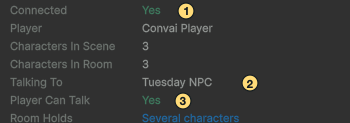
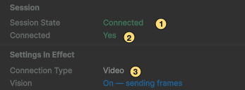

Before entering Play Mode, check the scene wiring and the character's installed modules. The scene validator checks the objects the runtime needs. The Troubleshooter explains which features can work on the selected character.

## Validate the scene wiring

Choose **GameObject > Convai > Validate Scene Setup**. If the scene uses Convai UI, import TextMesh Pro Essential Resources when prompted. Read the errors first, correct the affected objects, then run validation again.

| Finding | What to do |
| --- | --- |
| No manager, no player, or no character | Use **GameObject > Convai > Add Required Components** for the manager and room. Add `ConvaiPlayer` to the player and `ConvaiCharacter` to a character. |
| Missing or duplicate Character ID | Set the ID for each character that will join. Confirm each character in the room has its own ID. |
| Several players and none assigned | Set **Player** on `ConvaiManager`. Inactive players also count when the SDK checks for ambiguity. |
| Room component missing on the manager | If no room component exists, the manager adds one with defaults at startup. A room component on a different GameObject emits a warning because its settings will be ignored. Put the configured room on the manager. |
| Voice enabled but no audio source | Add `ConvaiAudioOutput` to the character. Unity also adds the required `AudioSource`. If the source already exists, the missing output component is a warning. |
| Vision enabled with no usable publisher or source | Complete the [Vision setup](../features/vision/quick-start.md) to send frames. A room can still connect without them. |

## Check an individual character

Select the character and open **Convai > Troubleshooter**. Review errors and warnings for the installed modules. Use the action on a finding when available, or follow its guidance in the component's Inspector. Choose **Re-check** after editing. See [Convai Troubleshooter](../troubleshooting/convai-troubleshooter.md) for the available actions.

## Verify a conversation

Enter Play Mode. Let **Connect On Start** open the room or use your application's connection control. Wait for the addressed character to be ready, send a typed message or speak, and check for a reply. Local validation can confirm wiring while an unavailable character, refused credential, or device permission still prevents a turn. Use [Connection and API issues](../troubleshooting/connection-and-api-issues.md) or [Audio and microphone issues](../troubleshooting/audio-and-microphone-issues.md) for those cases.

<figure><figcaption>
(1) Check that <strong>Connected</strong> reads Yes. (2) Read <strong>Talking To</strong> to identify the character. (3) <strong>Player Can Talk</strong> reads Yes when the addressed character can receive input.
</figcaption></figure>

<figure><figcaption>
(1) A joined room reports <strong>Session State</strong> as Connected. (2) <strong>Connected</strong> reads Yes. (3) Check <strong>Connection Type</strong> under <strong>Settings In Effect</strong>. This sample used Video.
</figcaption></figure>
