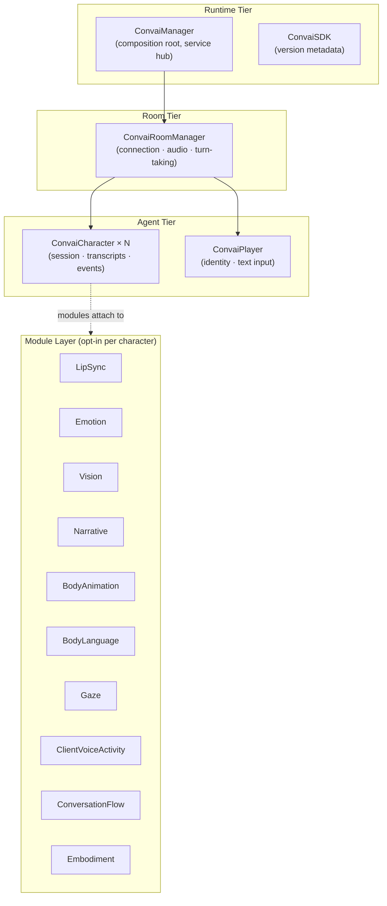

The SDK is organized into four tiers: Runtime, Room, Agent, and Module. As a developer, you interact primarily with the Agent tier (character and player components) and the Module layer (opt-in feature modules). The Runtime and Room tiers handle connection and service bootstrapping with minimal configuration required.

## System diagram

The dashed line marks optional character features. Most embodiment modules attach to the character. Vision publishers can live elsewhere, and on-device voice detection is created internally from room policy.

## Runtime tier

The Runtime tier boots when your scene loads and provides services to everything below it.

`ConvaiSDK` is a static class that exposes the SDK version (`ConvaiSDK.Version`). You rarely reference it directly.

`ConvaiManager` is the composition root. It is a singleton (`ConvaiManager.ActiveManager`) marked with `[DefaultExecutionOrder(-1100)]` so it initializes before other scene objects. It owns:

* **Service accessors** — `TryGet` methods for every internal service (microphone, audio, agent registry, notification, settings panel, etc.)
* **High-level facades** — `ConvaiManager.Audio`, `ConvaiManager.Transcripts`, `ConvaiManager.Events` for the most common scripting tasks
* **Connection control** — `ConnectAsync()`, `DisconnectAsync()`, `SetConversationInputModeAsync()`
* **Agent references** — `Characters`, `Player`, `ActiveConversationCharacter`


Most integration code only needs `ConvaiManager.ActiveManager` and the character's own events. The `TryGet` service accessors are for advanced use cases where you replace or extend internal services.


## Room tier

`ConvaiRoomManager` owns the live connection to Convai. One `ConvaiRoomManager` per scene, managed by `ConvaiManager`.

It is responsible for:

* **Room connection lifecycle** — connecting, disconnecting, reconnecting
* **Microphone capture** — starting and stopping audio input, mute control
* **Turn-taking mode** — hands-free (`ConversationInputMode.HandsFree`) or push-to-talk (`ConversationInputMode.PushToTalk`)
* **Dynamic context transport** — sending state updates and events to Convai at runtime
* **Audio playback coordination** — enabling remote character audio, WebGL user-gesture handling

`ConvaiManager.TryGetRoomConnectionService` exposes `IConvaiRoomConnectionService`: room state, events, and connection operations. It does not expose the internal diagnostics, audio, or ownership coordinators. Use the public room and facade APIs for advanced scripting.

## Agent tier

The Agent tier contains the components you place on scene GameObjects.

### ConvaiCharacter

Add `ConvaiCharacter` to each NPC or agent GameObject. One component per character. It owns:

* Character ID — the unique ID from your Convai dashboard
* Session state — `Disconnected`, `Connecting`, `Connected`, `Reconnecting`, `Disconnecting`, `Error`
* Conversation lifecycle — `StartConversationAsync()`, `StopConversationAsync()`, `ToggleSpeech()`
* Transcript and event callbacks — `OnSpokenLine`, `OnEmotionChanged`, `OnActionsReceived`, `OnSpeechStarted`, `OnSpeechStopped`, `OnCharacterReady`
* Action configuration — via `ConvaiActionConfigSource` component

`ConvaiCharacter` can be configured inline in the Inspector or via a reusable `ConvaiCharacterProfile` ScriptableObject asset.

### ConvaiPlayer

Add `ConvaiPlayer` to your player GameObject. One per scene is standard. It owns:

* Player display name and name tag color for transcript attribution
* Text message sending — `SendTextMessage(string message)`
* Runtime identity override — `SetRuntimeDisplayName(string displayName)`


`ConvaiPlayer.PlayerId` is a stable local identity for transcript attribution and ownership. It is separate from the end-user ID used for Long-Term Memory and the server transcript speaker ID. Renaming the player does not change it.


## Module layer

Embodiment modules attach to the character and share runtime context. Place `ConvaiVisionPublisher` on the Room Manager or under it so the room's validation and video-track-name discovery see it. The publisher registers with the active manager and resolves its frame source on itself or its children, unless a source is explicitly assigned. Add only the features your project needs.

| Module              | What it does                                                                                                     |
| ------------------- | ---------------------------------------------------------------------------------------------------------------- |
| LipSync             | Real-time blend shape mouth animation driven by audio playback; supports ARKit, MetaHuman, and CC4 Extended maps |
| Emotion             | Receives Convai emotion signals, smooths them, and dispatches to semantic facial expressions and material-property bindings      |
| Vision              | Publishes camera, webcam, or Meta Quest passthrough frames to Convai for multimodal awareness                    |
| Narrative           | Manages story section progression through trigger-based events tied to conversation flow                         |
| BodyAnimation | Plays idle, talk, locomotion and gesture clips through a PlayableGraph, without requiring an Animator Controller. |
| BodyLanguage | Adds posture, breathing and conversational gestures to character motion. |
| Gaze | Coordinates torso, head, eyes and eyelids through `ConvaiGazeController`. |
| ClientVoiceActivity | Provides optional native on-device voice detection from room policy; the Sentis detector is internal, not an addable component. |
| ConversationFlow    | Bridges the conversation event stream to per-frame dialogue state (Idle, Speaking, Reacting, etc.)               |
| Embodiment          | Foundational behavior profile and lifecycle management for physical presence and behavioral modules              |

`ConversationFlow` can be added on demand in Play Mode by Gaze, Body Animation, Body Language, or Emotion when its configured reactions need it. A bare `ConvaiCharacter` does not provision it; default Emotion strengths do not request it. Other feature modules are enabled through their components or room policy. The retired Dialogue Animation, Facial Animation and Attention components are not the current embodiment setup.

## Supporting components

`ConvaiAudioOutput` routes a character's voice to its required AudioSource. `ConvaiSceneInstaller` provides explicit scene-agent registration and ownership. `ConvaiPushToTalkController` accepts custom input; a manager input lease disables the built-in bindings while your input owns the controller.

`ConvaiGroupConversation` opts a room into the group-conversation contract. Its simulator rehearses local behavior without proving a live backend session. See [Group conversation](../features/group-conversation/README.md).

## Configuration model

The character and room manager support two configuration sources, selectable in the Inspector. Other features use their own configuration surfaces.



Values are set directly on the component in the Inspector. This is the default mode and is suitable for most scenes — no additional assets required.



Values come from a reusable `ConvaiCharacterProfile` or `ConvaiRoomManagerProfile` ScriptableObject. Use this when you want shared defaults across multiple scenes or prefab variants, or when you need to swap character behavior without modifying individual prefabs.



A character can also select Live or pin an API-returned released version. See [Pin a character version](../getting-started/pin-a-character-version.md).

## Next steps


[Feature map](feature-map.md)



[Getting Started](../getting-started/README.md)

