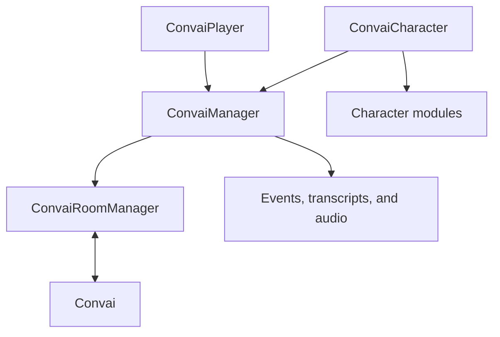

The `ConvaiManager` in your scene starts the runtime. A `ConvaiRoomManager` on the same GameObject connects to Convai. Character and player components provide the identities for the conversation. Optional modules add capabilities such as gaze, actions, or facial animation.

## From scene to room

The room owns the shared connection, microphone policy, and input mode. A character can be present in the scene before it is ready to take a turn. In a shared room the addressed character can change while the connection stays open. Use [Conversation availability](../features/conversation-availability/README.md) to decide when your UI should accept input.

## Where to configure the scene

| Scope | Owner | Examples |
| --- | --- | --- |
| Project | **Convai > Settings** | Credentials, service environment, logging, and runtime defaults |
| Scene | `ConvaiManager` | Player selection, character roster, and initial conversation target |
| Room | `ConvaiRoomManager` | **Connect On Start**, hands-free or push-to-talk input, microphone access, and vision |
| Character | `ConvaiCharacter` | Character ID, version selection, session resume, and voice playback |
| Character feature | The relevant module or profile | Lip sync mapping, emotion bindings, body animation, and gaze |

Room and character settings are saved on components. Prefabs let several scenes reuse the same settings. Individual embodiment modules can have their own profile assets. See [Scene components](../getting-started/scene-components.md) and [Embodiment](../embodiment/README.md).

## Where scripts connect

After `manager.IsInitialized`, use `manager.Audio` for microphone and character playback, `manager.Transcripts` for conversation history and captions, and `manager.Events` for scene-wide events. Use `character.StartConversationAsync()` to wait for a particular character, or `manager.ConnectAsync()` to open the room. Use `manager.DisconnectAsync()` to close it.

Subscribe to `ConvaiCharacter.OnSpokenLine` for that character's spoken text. Use the transcript facade if you need entry IDs, revisions, speaker attribution, replay, or text from a silent reply. See [Session lifecycle](../core-concepts/session-lifecycle.md), [Character events](../scripting-reference/character-events.md), and [Transcript API](../scripting-reference/transcript-api.md).
