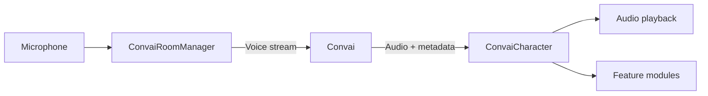

The Convai Unity SDK connects Unity characters to Convai so they can speak, listen, reason, and act in real time. A player speaks into a microphone; the SDK captures audio, streams it to Convai for speech recognition and language understanding, generates a response with text-to-speech, and plays it back on the character with synchronized lip sync, facial emotion, and optional in-scene actions. The SDK targets Unity developers building training simulations, interactive experiences, and games.

## What it includes

The SDK ships with a complete conversation pipeline and a set of opt-in feature modules.

### Conversation pipeline

The ordinary voice workflow includes:

* **Real-time voice input** — microphone capture, streaming speech recognition
* **Language understanding and generation** — Convai processes and responds in character
* **Text-to-speech** — voice generated by Convai, played back through Unity audio

### Feature modules

Optional features, configured through scene components, room policy or service settings:

* **Lip sync** — real-time blend shape mouth animation; supports ARKit, MetaHuman, and CC4 Extended maps
* **Emotion** — maps Convai emotion signals to semantic facial expressions and material properties
* **Actions** — character executes structured in-scene commands dispatched by Convai
* **Long-term memory** — character remembers each player across separate sessions
* **Narrative design** — trigger-based story section progression tied to conversation flow
* **Vision** — character sees through a Unity camera, webcam, or Meta Quest passthrough
* **Dynamic context** — inject runtime state and events into the character's knowledge at any time

The SDK also supports [multi-character rooms](../features/multi-character-sessions/README.md), [target selection](../features/conversation-targeting/README.md), [input availability](../features/conversation-availability/README.md), and [scene metadata](../features/scene-metadata/README.md). Native on-device voice detection uses the optional Sentis/Silero implementation selected in room policy. The 5.0 preview adds [group conversation](../features/group-conversation/README.md) and [text-only sessions](../getting-started/run-a-text-only-session.md).

### Utilities

Optional helpers that run entirely in Unity without Convai communication:

* **Body Animation** — idle, talk, locomotion and gestures through a PlayableGraph.
* **Gaze** — coordinated torso, head, eye and eyelid movement toward conversation partners and scene targets.
* **Body Language** — posture, breathing and nonverbal responses.
* **Conversation Flow** — shared conversation phase for local behavior.

### Editor tooling

**Convai > Convai Editor** and **Convai > Settings** provide project configuration. The Convai menu also exposes Actions, Body Animation, Emotion, Gaze and Embodiment editors, the Troubleshooter, scene setup and validation, documentation links and Platform Support tools for native transport libraries. The [Scene Auto Tagger](../features/scene-metadata/scene-auto-tagger.md) has separate distribution prerequisites. Not every SDK component has a custom Inspector.

## Voice → Convai → Character flow

`ConvaiRoomManager` handles the streaming connection to Convai. `ConvaiCharacter` receives the response — audio, transcript, emotion signals, and action commands — and routes each to the appropriate module or output.

## Requirements

| Requirement     | Minimum                                                |
| --------------- | ------------------------------------------------------ |
| Unity version   | <code class="expression">space.vars.unity_min_version</code> |
| Render pipeline | Built-in, URP, or HDRP                                 |
| Platform        | Windows, macOS, Linux, Android, iOS, Meta Quest, WebGL |
| Network         | Internet connection to Convai                          |
| API key         | Free account at [convai.com](https://www.convai.com/)  |


The sample scenes use URP. If your project uses the Built-in render pipeline, the samples require minor material reassignment. The SDK itself works with all three pipelines.


An SDK distribution is available on the [Unity Asset Store](https://assetstore.unity.com/packages/tools/behavior-ai/npc-ai-engine-dialog-actions-voice-and-lipsync-convai-235621). Check that channel's listed version; this 5.0 preview does not establish that 5.0 is available there.

For the full platform and Unity version support matrix, see Compatibility and requirements.


[Compatibility and requirements](../compatibility-and-requirements/README.md)


## Next steps

Install the SDK and add your first character.


[Getting Started](../getting-started/README.md)


To understand the system architecture before setting up, see the architecture page next.


[Convai Unity SDK architecture](convai-unity-sdk-architecture.md)

