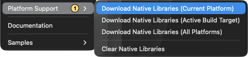
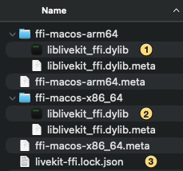

Native players need a LiveKit FFI library, the native bridge used by the managed SDK. The Editor downloader installs it into the project; it is not shipped inside the SDK package. WebGL uses its browser transport instead.

## Install the required targets



### Allow release downloads

The SDK pins LiveKit FFI <code class="expression">space.vars.unity_native_ffi_version</code> and archive checksums. The downloader retrieves release assets from `github.com/livekit/rust-sdks/releases/download`. Allow GitHub and its release-download redirects on the development or build machine.



### Select a download scope

The downloader runs on Editor load for the Editor platform and active build target. To retry or prepare another target, use **Convai > Platform Support**.

<figure><figcaption><p>Open (1) <strong>Platform Support</strong> from the <strong>Convai</strong> menu, then choose the download scope for your project.</p></figcaption></figure>

| Menu action | Scope |
| --- | --- |
| Download Native Libraries (Current Platform) | The current Editor platform. |
| Download Native Libraries (Active Build Target) | Architectures selected for the active player target. |
| Download Native Libraries (All Platforms) | Every architecture listed in the package manifest. |

Wait for download and import before connecting or building. Newly downloaded libraries stay disabled until the Editor applies platform and architecture settings. Redownloading preserves existing importer metadata.



### Verify files and the player

Check the project-local directory:

```text
Assets/Convai/Plugins/client-sdk-unity-livekit/Runtime/Plugins
```

<figure><figcaption><p>This macOS project has (1) an ARM64 library, (2) an Intel x86_64 library, and (3) the <code>livekit-ffi.lock.json</code> lockfile.</p></figcaption></figure>

Confirm the expected architecture is present and the Console has no download, checksum or import failure. Build for the intended target, launch that player and complete a voice or text turn. A successful Editor connection only tests the Editor's native library.



## Architectures in the SDK manifest

| Platform | Manifest architectures |
| --- | --- |
| Windows | x86_64, arm64 |
| macOS | x86_64, arm64; Universal player assembly uses both slices |
| Linux | x86_64 |
| Android | arm64, armv7, x86_64 |
| iOS | arm64 device, sim-arm64 |

Windows automatic target selection normally fetches x86_64. Use **All Platforms** when preparing the Windows arm64 library. There is no Linux arm64 or Intel iOS simulator library in this manifest.

The macOS build processor combines both native slices for a Universal player. Preserve that build step and verify the packaged application on the architectures you distribute.

## Resolve a loading failure

| Symptom | Check |
| --- | --- |
| Download fails | Network access to GitHub releases and redirect hosts; retry the matching menu action. |
| Checksum mismatch | Retry through the downloader using the package's pinned manifest; do not substitute an arbitrary native release. |
| `DllNotFoundException` for `livekit_ffi` | Target architecture, imported library and the built player's plugin contents. |
| Editor works but player fails | The player may require a different architecture or importer configuration. |
| Universal macOS player fails | Confirm both input slices and the build processor's combined output. |

Keep the managed LiveKit code, native manifest and downloaded binaries from the same SDK distribution. Updating only one side can create a binding mismatch.
