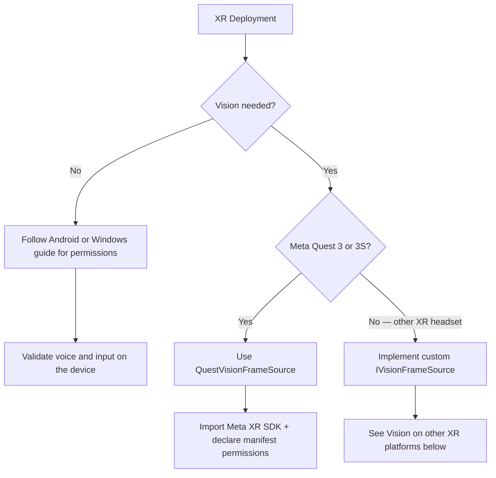

XR applications use the underlying Android or Windows runtime path. Configure native libraries, microphone access and input for the headset. Passthrough vision additionally needs a camera integration supported by that device; verify each headset model in a built application.


Convai Unity VR setup for Meta Quest


## Core feature support

| Feature              | Android XR (Meta Quest, Horizon OS)            | Windows XR                              |
| -------------------- | ---------------------------------------------- | --------------------------------------- |
| Voice conversation   | ✅ Implemented                                         | ✅ Implemented                                  |
| Lip sync             | ✅ Implemented                                         | ✅ Implemented                                  |
| Actions              | ✅ Implemented                                         | ✅ Implemented                                  |
| Emotion              | ✅ Implemented                                         | ✅ Implemented                                  |
| Long-Term Memory     | ✅ Implemented                                         | ✅ Implemented                                  |
| Narrative Design     | ✅ Implemented                                         | ✅ Implemented                                  |
| Vision (passthrough) | ✅ `QuestVisionFrameSource` (Quest 3 / 3S only) | ⚠️ Custom `IVisionFrameSource` required |
| Spatial audio        | ✅ Implemented                                         | ✅ Implemented                                  |

For Android-based XR headsets, all core setup follows the Android platform guide — including verification of the generated `RECORD_AUDIO` manifest entry and the SDK's runtime permission flow. A custom manifest must not strip the permission.


[iOS and Android](ios-and-android.md)


## Push-to-talk on Meta Quest

Set **Push To Talk Key** to `JoystickButton0`, `JoystickButton1`, `JoystickButton2` or `JoystickButton3` to use right A, right B, left X or left Y through Unity's XR input API. The default `T` remains a keyboard binding. If the active XR controller cannot be read, or disconnects mid-press, the SDK fails closed and stops microphone capture rather than leaving it open. Keyboard and non-XR joystick input are unaffected. See [Configure conversation input mode](../getting-started/configure-conversation-input-mode.md) for the full button mapping.

For a custom XR input system, acquire `ConvaiManager.AcquirePushToTalkInput()` and drive the controller through `Press()` and `Release()`. `Press(true)` is only for an input source that can reliably observe release through focus loss. See [Use your own push-to-talk input](../getting-started/use-your-own-push-to-talk-input.md).

Use this decision tree to choose a Vision source after configuring input and permissions:



## Vision on Meta Quest

`QuestVisionFrameSource` streams the passthrough camera feed from a Meta Quest 3 or 3S headset to Convai, enabling the AI character to see and respond to the real world the learner is looking at. The component uses reflection to bind to the Meta XR SDK's `PassthroughCameraAccess` at runtime — the Convai SDK has no hard compile-time dependency on any Meta SDK package.

For the complete setup guide, Inspector reference, and troubleshooting steps, see the Meta Quest Vision setup page.

<table data-view="cards"><thead><tr><th></th><th data-hidden data-card-target data-type="content-ref"></th></tr></thead><tbody><tr><td><strong>Meta Quest Vision setup</strong><br>Configure QuestVisionFrameSource, declare required manifest permissions, and validate passthrough Vision on Quest 3 and 3S.</td><td><a href="meta-quest-vision.md">meta-quest-vision.md</a></td></tr></tbody></table>

## Vision on other XR platforms

No built-in passthrough frame source exists for non-Meta XR headsets — OpenXR-only devices, Windows Mixed Reality, HoloLens, or Android XR platforms that do not expose a passthrough camera through the Meta XR SDK.

To enable passthrough Vision on these devices, implement `IVisionFrameSource` using a camera API the device permits your application to access. The skeleton below only shows the interface; its comments must be replaced with capture, frame delivery and resource cleanup before it can publish images:


```csharp
using System;
using Convai.Runtime.Vision.Sources;
using UnityEngine;

public class CustomXRVisionFrameSource : MonoBehaviour, IVisionFrameSource
{
    [SerializeField] private float _targetFrameRate = 15f;
    [SerializeField] private string _sourceId = "custom-xr";

    private RenderTexture _renderTexture;

    public bool IsCapturing { get; private set; }
    public long FrameCount { get; private set; }
    public (int Width, int Height) FrameDimensions => (_renderTexture ? _renderTexture.width : 0,
                                                       _renderTexture ? _renderTexture.height : 0);
    public float TargetFrameRate => _targetFrameRate;
    public string SourceId => _sourceId;
    public RenderTexture CurrentRenderTexture => _renderTexture;
    public bool IsFrameReady { get; private set; }

    public event Action FrameReady;

    public void StartCapture()
    {
        // Initialize your XR SDK camera and RenderTexture here.
        // Each time a new frame is available, blit it into _renderTexture (top-down / Y-flipped),
        // then increment FrameCount, set IsFrameReady = true, and raise FrameReady?.Invoke().
        IsCapturing = true;
    }

    public void StopCapture()
    {
        IsCapturing = false;
        IsFrameReady = false;
    }
}
```


Assign your custom source to `ConvaiVisionPublisher` via its Inspector field. See the Vision feature documentation for the full `IVisionFrameSource` contract, publishing policies, and debug preview setup.

## Next steps


[Meta Quest Vision setup](meta-quest-vision.md)



[iOS and Android](ios-and-android.md)

