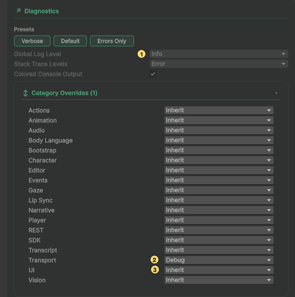
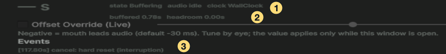

Use the Convai Troubleshooter for setup findings. During Play Mode, use the feature windows, room Inspector, and Console to investigate the connection, action dispatch, and playback timing.

## Convai Troubleshooter

`Convai → Troubleshooter` reports what is stopping a `ConvaiCharacter` from working, module by module, with a fix beside each finding. Start here before the tools further down this page — most setup mistakes surface in the Troubleshooter with a one-click fix, without needing a Console search.


[Convai Troubleshooter](convai-troubleshooter.md)


## Per-module editor windows

Each embodiment module and Actions has its own authoring and diagnostic window, reached from the `Convai` menu:

| Window | Menu path | What it shows |
| --- | --- | --- |
| Actions Editor | `Convai → Actions Editor` | Authoring, testing, and a **Live** tab — the batch in progress, a timeline of recent batches with each step's duration and outcome, the merged target registry, and per-action insights |
| Embodiment Editor | `Convai → Embodiment Editor` | **Setup**, **Presets**, and **Live** tabs for a character's embodiment stack |
| Gaze Editor | `Convai → Gaze Editor` | Setup and tuning for the Gaze module |
| Body Animation Editor | `Convai → Body Animation Editor` | Setup and tuning for the Body Animation module |
| Emotion Editor | `Convai → Emotion Editor` | Setup, the resolved expression mapping for the character's face, and a live view in Play mode |

## Diagnostics

Logging configuration lives in the Diagnostics section, reachable from `Convai → Settings` and from `Edit → Project Settings → Convai SDK`.

### Where to configure

Open `Convai → Settings` or `Edit → Project Settings → Convai SDK` and scroll to the **Diagnostics** section. Both entry points render the same `DiagnosticsSectionView`, so a change made in one place shows up in the other. The settings that control what appears in the Unity Console are:

* **Presets** — one-click buttons that set Global Log Level, Stack Trace Levels, and Colored Console Output together; see [Logging presets](#logging-presets)
* **Global Log Level** — minimum verbosity that applies to all log categories
* **Stack Trace Levels** — a severity mask selecting which entries include stack traces
* **Colored Console Output** — whether log entries are color-coded in the Unity Console
* **Category Overrides** — per-subsystem overrides that supersede the global level

The Diagnostics section header also has its own **Reset** button, which applies the same configuration as the `Default` preset below.

### Logging presets

Three preset buttons sit above the Global Log Level field. Each preset sets the global level, stack-trace mask, and color flag together, then clears every category override.

| Preset | Global Log Level | Stack Trace Levels | Colored Console Output | Category Overrides |
| --- | --- | --- | --- | --- |
| `Verbose` | `Trace` | `Warning` + `Error` | On | Cleared |
| `Default` | `Info` | `Error` | On | Cleared |
| `Errors Only` | `Error` | `Warning` + `Error` | On | Cleared |

`Default` matches the SDK's default logging configuration. Applying any preset overwrites Global Log Level, Stack Trace Levels, and Colored Console Output, and removes existing Category Overrides — reapply project-specific overrides after clicking a preset.

### Log levels

The SDK uses six log levels. Higher numeric value means more verbose.

| Level | Value | What appears in the Console |
| --- | --- | --- |
| **Off** | 0 | Nothing — silences all SDK logging |
| **Error** | 1 | Errors only |
| **Warning** | 2 | Errors and Warnings |
| **Info** | 3 | Errors, Warnings, and Info messages _(default)_ |
| **Debug** | 4 | All of the above plus Debug messages |
| **Trace** | 5 | Everything, including fine-grained internal traces |

The default is **Info**. Switching to **Debug** during an investigation produces significantly more output — disable it before releasing to production. Set **Global Log Level** to **Off** to silence all SDK logging.


`Debug`-level calls in the SDK source are decorated with `[Conditional("UNITY_EDITOR")]`, `[Conditional("DEVELOPMENT_BUILD")]`, and `[Conditional("CONVAI_DEBUG_LOGGING")]`. This means **Debug log calls are compiled out of non-development builds** unless you add `CONVAI_DEBUG_LOGGING` to your scripting define symbols. Setting `GlobalLogLevel` to `Debug` in a release build will not produce Debug messages because the call sites do not exist in the compiled code. Debug messages remain active in the Unity Editor and in Development Builds without any additional defines. `[ClientLatency]` summaries use Info level and have a separate room debug-mode gate.


To enable Debug messages in a production build, add `CONVAI_DEBUG_LOGGING` to **Edit → Project Settings → Player → Scripting Define Symbols**.

### Log category overrides

Category overrides let you increase verbosity for one subsystem without flooding the Console with output from others. For example, to diagnose a transport issue without seeing audio, UI, and character logs:

1. Open **Diagnostics** and expand the **Category Overrides** foldout — it lists every log category with a dropdown that defaults to `Inherit`
2. Set the `Transport` dropdown to `Debug`

All other categories remain at the global level. The foldout title shows the active override count, for example **Category Overrides (1)**. Set a category's dropdown back to `Inherit` to remove that override.

<figure><figcaption><p>(1) <strong>Global Log Level</strong> is <strong>Info</strong>. (2) <strong>Transport</strong> overrides it with <strong>Debug</strong>. (3) <strong>UI</strong> keeps <strong>Inherit</strong> and uses the global level.</p></figcaption></figure>

### Log category reference

| Category | Subsystem it covers |
| --- | --- |
| `SDK` | General SDK operations and initialization |
| `Character` | Character and NPC lifecycle |
| `Audio` | Audio output and microphone input |
| `UI` | Transcript UI and notification components |
| `REST` | REST API calls to Convai |
| `Transport` | LiveKit and WebRTC transport layer |
| `Events` | Event relay system (session, character, transcript events) |
| `Player` | Player identity and input |
| `Editor` | Editor-only tools and validators |
| `Vision` | Camera capture and video publishing |
| `Bootstrap` | SDK initialization and ConvaiSettings loading |
| `Transcript` | Transcript processing and routing |
| `Narrative` | Narrative design and story trigger system |
| `LipSync` | Lip sync processing and blendshape playback |
| `Animation` | Body animation system (layers, transitions, locomotion) |
| `Gaze` | Gaze system (targeting, policy, eye/head/body solvers) |
| `BodyLanguage` | Body language system (gesticulation, posture, breathing, fidgets) |
| `Actions` | Action system: which commands arrived, which were dropped and why, and how targets resolved |

### Custom log sinks

Forward SDK log entries to a custom destination — a file, telemetry service, or in-game debug overlay — by implementing `ILogSink` and registering it with `ConvaiLogger`.

`ILogSink` requires these members:

| Member | Description |
| --- | --- |
| `string Name { get; }` | Sink identifier shown in diagnostics |
| `bool IsEnabled { get; }` | Returns `false` to pause the sink without unregistering it |
| `void SetEnabled(bool enabled)` | Toggle the sink at runtime |
| `void Write(in LogEntry entry)` | Called for each log entry that passes the level filter |
| `bool IsEnabledFor(LogLevel level, LogCategory category)` | Thread-safe, nonblocking per-entry filter |
| `void Flush()` | Flush any buffered entries — call before application shutdown |
| `void Dispose()` | Clean up resources when the sink is removed |


```csharp
using System.IO;
using Convai.Domain.Logging;

public class FileLogSink : ILogSink
{
    private readonly string _path;
    private volatile bool _enabled = true;

    public FileLogSink(string path) => _path = path;

    public string Name => "FileLogSink";
    public bool IsEnabled => _enabled;
    public void SetEnabled(bool enabled) => _enabled = enabled;

    public bool IsEnabledFor(LogLevel level, LogCategory category) => _enabled;

    public void Write(in LogEntry entry)
    {
        string line = $"[{entry.Level}][{entry.Category}] {entry.Message}";
        File.AppendAllText(_path, line + "\n");
    }

    public void Flush() { }
    public void Dispose() { }
}
```


Register the sink early — in `Awake()` or a `[RuntimeInitializeOnLoadMethod]` callback — before any Convai component activates. `ConvaiLogger` auto-initializes on first use; sinks registered after initialization only receive subsequent messages.

```csharp
// Method inside your MonoBehaviour, with Convai.Runtime.Logging imported.
private void Awake()
{
    ConvaiLogger.RegisterSink(new FileLogSink(UnityEngine.Application.persistentDataPath + "/sdk.log"));
}
```

Remove a sink when it is no longer needed:

```csharp
ConvaiLogger.UnregisterSink(mySink);
```

`ConvaiLogger.SinkCount` returns the number of currently registered sinks. `ClearSinks()` retires all registered sinks, including `UnityConsoleSink`. It is restored at the next subsystem-registration reset, not by merely reading a logger again. A sink that throws three consecutive delivery/filter failures stops receiving entries. Re-registering an active instance resets its failure count; an unregistered or cleared instance is retired and cannot be registered again. Create a fresh instance after retirement.

## Inspect an action in Play Mode

Open **Convai > Actions Editor > Live** to see action batches, individual step outcomes, and resolved targets. Use its test action workflow to reproduce a local dispatcher issue. Then check a real conversation when you need to verify delivery from Convai.

## Room connection state

Inspect the room manager's **Runtime** section in Play Mode. The room manager exposes `ConnectAttemptCount`, `ReconnectCount`, `LastSuccessfulConnectionUtc`, `LastSessionErrorCode`, and `LastSessionErrorMessage`. The counters belong to the current room runtime. Observe `ConvaiManager.Events.OnSessionStateChanged` for transitions and `OnSessionError` for errors.

The room Inspector can copy the latest connect response without its token. Check the remaining session and room details before sharing the output. See [Connection and API issues](connection-and-api-issues.md).

## Client latency metrics

`ClientLatencyMetricsCollector` records client observation timestamps while the room manager's debug mode is enabled. Its summary uses Info logging, so it is not compiled out by the Debug-log build defines. Enable the room's debug option before connection and allow Info output for the relevant category.

A summary can contain these segments; fields are omitted when their signals were not observed:

| Segment | Client-observed interval |
| --- | --- |
| `stop→finalTranscript` | Player stop to final player transcript |
| `stop→firstTranscript` | Player stop to first character transcript |
| `stop→ttsStarted` | Player stop to the TTS-start notification |
| `stop→firstLipSync` | Player stop to first lip-sync data |
| `stop→audioPlaying` | Player stop to playback notification |
| `ttsNotificationToPlaybackNotification` | TTS-start notification to playback notification |

The last interval is not a direct audio-buffer-fill or DAC measurement. Compare observations from the same client and investigate missing or delayed signals before attributing the difference to a particular service.

Optional `ClientBargeIn` details describe local interruption-detector activity. `[ClientBargeIn]` debug lines still follow the Debug-log build and level filters.

## LipSync drift monitor

Custom runtime sink injection is not supported — the SDK has no public extension seam for it. Drive lip sync through a supported map or profile on `ConvaiLipSyncComponent` instead. The related types `SkinnedMeshBlendshapeSink`, `LipSyncDriftMonitor`, `LipSyncDriftSample`, and `LipSyncDriftEvent` exist in the SDK but are internal, not part of the public API.

Open the drift monitor from a character's `ConvaiLipSyncComponent` Inspector: select **Open Lip Sync Drift Monitor** under **Streaming & Latency**. The window opens titled **Lip Sync Drift Monitor**.

Monitoring is opt-in: enable the **Monitor** toggle, enter Play mode, and talk to a character to populate data. Select a character from the dropdown when more than one is registered — samples and events are tracked per character.

The window reports the playback state, audio activity and clock mode, buffer and headroom, and the audio target time while audio is active. It also has a live audio/visual offset override and a timestamped event log.

<figure><figcaption><p>Read the state, audio activity, and clock together (1), then check the buffer and headroom (2). The event list (3) shows when playback events occurred. The example shows a buffering sample and a retained cancellation event.</p></figcaption></figure>

Click **Export CSV** to save the current samples and events. The sample table contains `time_s`, `audio_target_s`, `buffered_s`, `headroom_s`, `state`, `clock_mode`, and `audio_active`. The event table contains `event_time_s` and `label`.


## Quick reference

| Tool | What to check |
| --- | --- |
| **Convai > Troubleshooter** | Setup findings and available fixes for a character or the open scene. |
| **Convai > Actions Editor > Live** | Action batches, outcomes, and targets in Play Mode. |
| **Convai > Settings > Diagnostics** | Log filters and verbosity. |
| **Room Manager > Runtime** | Connection state and connect response details. |
| **LipSync Drift Monitor** | Audio and facial animation timing in Play Mode. |
| `Convai_DiagnoseConversation` | Read-only readiness and target routing from an [AI coding assistant](../ai-coding-assistant/README.md). |

## Next steps

For platform-specific issues — WebGL AudioContext unlock, Android microphone handling, or platform build settings — see the Platform Guides section.


[Platform guides](../platform-guides/README.md)


For feature-specific diagnostic tools, see the troubleshooting page inside each feature's section. The Actions, Emotion, Vision, and Narrative Design features each have detailed decision trees and console log references beyond what is covered here.
