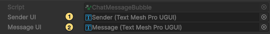
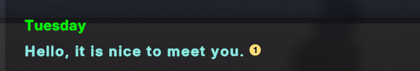

Customize the built-in prefab visuals to keep their behavior, or subscribe to `ConvaiManager.Transcripts` to build your own display. This guide assumes a scene with an initialized `ConvaiManager` and a working [transcript UI](transcript-ui/).

## Filter a custom transcript display

Use `TranscriptSubscriptionOptions` with `Transcripts.Subscribe` for history changes. Set `SpeakerType`, `SpeakerId`, or `ParticipantId` to select a speaker. Use `TranscriptCaptionSubscriptionOptions` with `SubscribeCaptions` for text as it is spoken. Both return an `IDisposable` subscription; dispose it when the display stops listening.

For a label on one character, use [Convai Transcript Display](transcript-ui/per-character-transcript-display.md). For Inspector events, add `ConvaiTranscriptEventRelay`. It forwards entry changes even when transcript presentation is disabled. A custom UI must honor `IsPresentationEnabled` and `PresentationEnabledChanged` itself.

The SDK does not ship `TranscriptFilterBase`, `SingleCharacterFilter`, `ProximityCharacterFilter`, or `IVisionConeProvider`. If your application needs distance or vision-cone filtering, calculate visibility in your own component and use that result to choose which subscribed entries to render. See [Transcript history and queries](transcript-ui/transcript-history-and-queries.md) for the supported API.

## Restyle chat message bubbles



### Copy the chat prefab into your project

Duplicate `TranscriptUI_Chat.prefab` or `TranscriptUI_Chat_WorldSpace.prefab` from the package's `Prefabs/TranscriptUI/` folder. Work on your project copy so a package update does not replace your changes.


### Edit the embedded bubble templates

The shipped bubble templates are child objects inside the chat prefabs, not separate bubble prefab assets. Find the objects assigned to `characterMessagePrefab` and `playerMessagePrefab` on `ChatTranscriptUI`. Restyle their fonts, backgrounds, and layout, or extract your own prefab and assign it to the corresponding field.

Retain `ChatMessageBubble` and its `senderUI` and `messageUI` references to `TextMeshProUGUI` components. Keep the fields assigned even if your design hides the sender label.

<figure><figcaption>
(1) <strong>Sender UI</strong> points to the name label. (2) Follow <strong>Message UI</strong> to style the reply text.
</figcaption></figure>



### Check a streamed reply

Enter Play Mode and send a message. Confirm that player and character bubbles use your templates, streamed text updates in the existing bubble, and a second reply creates the expected next bubble.

<figure><figcaption>
(1) The new reply uses the bold teal text set on the character template’s <strong>Message</strong> label.
</figcaption></figure>




The bubble exposes these presentation methods:

| Method | Effect |
| --- | --- |
| `SetSender(string)` | Set the speaker label |
| `SetSenderColor(Color)` | Override the label color, saving the original color |
| `ResetSenderColor()` | Restore the saved color |
| `SetMessage(string)` | Replace the stored text |
| `AppendMessage(string)` | Append to the stored text |
| `SetSenderUIActive(bool)` / `SetMessageUIActive(bool)` | Show or hide the respective label |

Sender and message text render as plain text with rich text disabled. The displayed message is trimmed at both ends; the stored text remains untrimmed so streamed appends retain spacing. Response feedback components and bubble feedback methods are removed in the preview. See [Transcript migration](../scripting-reference/migrate-transcripts-to-5-0.md).

## Restyle notification prefabs

Duplicate `Notification.prefab` from `Prefabs/Notifications/` and assign your copy to `UINotificationController.uiNotificationPrefab` on a project copy of the notification system. Preserve these `UINotification` references:

| Field | Type | Purpose |
| --- | --- | --- |
| `notificationRectTransform` | `RectTransform` | Slide positioning |
| `notificationIcon` | `Image` | Optional icon |
| `notificationTitleText` | `TextMeshProUGUI` | Title |
| `notificationMessageText` | `TextMeshProUGUI` | Body |

Trigger an assigned notification after enabling notifications in runtime settings. Confirm that the copied skin appears and clears. See [Notification system](notification-system/) for alert setup and queuing.

## Build a custom settings view

Use `ConvaiManager.TryGetRuntimeSettingsService` after initialization. Populate your UI from `Current`, read available microphones with `TryGetMicrophoneDeviceService` and `GetAvailableDevices()`, then call `Apply` with a `ConvaiRuntimeSettingsPatch` when the player saves. Subscribe to `Changed` while your view is enabled.

Use `ConvaiManager.SetConversationInputModeAsync` separately for an active room mode change. Read back `ActiveConversationInputMode` after the operation. Use `TryGetSettingsPanelController` if your custom view shares the existing panel's open and close controls.

Verify that saving updates `Current` and that a later scene uses the saved preference. See [Runtime settings API](settings-panel/runtime-settings-api.md) for normalization and persistence.

## Troubleshooting

| Symptom | Cause | Fix and verification |
| --- | --- | --- |
| A copied bubble is blank | Missing text references | Assign `senderUI` and `messageUI`, then send another message |
| A custom display shows text while transcripts are off | It treats an event subscription as a presentation toggle | Observe `IsPresentationEnabled` and its change event; toggle Transcript and confirm the display hides |
| A custom settings view does not save | The UI has no settings service or did not apply a patch | Resolve the service, apply changes, and inspect the result |
| A notification still uses the default skin | The controller references the package prefab | Assign your copied notification prefab and request the assigned asset |

## Next steps


[Transcript history and queries](transcript-ui/transcript-history-and-queries.md)

