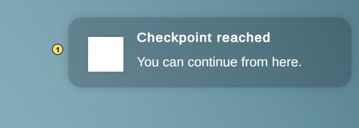

The notification system displays toast-style alerts from `SONotification` assets. Automatic alerts are disabled in the project runtime defaults. This guide assumes a scene with an initialized `ConvaiManager`.

## Add the notification system



### Add the shipped prefab

Drag `Prefabs/Notifications/NotificationSystem.prefab` from the <code class="expression">space.vars.sdk_package_id</code> package into your scene. It supplies `NotificationHandler` and the notification controller.



### Enable notifications

Enable **Notifications** in the runtime settings panel, or set the project default in **Convai → Settings → Runtime Defaults**. Saved runtime overrides take precedence over project defaults. You can also apply `ConvaiRuntimeSettingsPatch.NotificationsEnabled = true` from code.


### Create a custom alert

Create an asset with **Create → Convai → Notification System → Notification**. Set its title, message, optional icon, and a unique ID. An empty serialized ID falls back to the asset name.



### Test an alert

Assign the asset to the component below and invoke `ShowAlert()` from a scene button. Confirm that its title and message appear, then clear after the animation cycle. `DismissAll()` clears visible and queued alerts.

<figure><figcaption><p>(1) The sample displays the title and message from the notification asset in the upper-right corner of the Game view.</p></figcaption></figure>




## Trigger notifications from code

The example resolves the service at the moment you request an alert:

```csharp
using Convai.Runtime.Components;
using Convai.Shared.Notifications;
using UnityEngine;

public class ScenarioNotifier : MonoBehaviour
{
    [SerializeField] private SONotification alert;

    public void ShowAlert()
    {
        var manager = ConvaiManager.ActiveManager;
        if (manager != null && alert != null &&
            manager.TryGetRuntimeSettingsService(out var settings) &&
            settings.Current.NotificationsEnabled &&
            manager.TryGetNotificationService(out var service))
            service.RequestNotification(alert);
    }

    public void DismissAll()
    {
        var manager = ConvaiManager.ActiveManager;
        if (manager != null && manager.TryGetNotificationService(out var service))
            service.DismissNotification();
    }
}
```

The handler displays the asset you pass. The example checks the runtime preference before requesting a custom alert. The service itself delivers explicit requests without applying that preference.

## Automatic error notifications

The runtime notification bridge maps session errors through the packaged `Resources/SONotificationErrorMap` asset. Its 19 ordered rules choose the first matching notification. For example, exact `connection.auth_failed` and `connection.rate_limited` rules should precede a broader `connection.` prefix rule.

The bridge suppresses repeated automatic notifications with the same ID for 10 seconds. Direct `IConvaiNotificationService.RequestNotification` calls do not have that cooldown; add application-level deduplication if your event can fire repeatedly.

The built-in runtime host owns its bridge. There is no `NotificationHandler` Inspector field for replacing the host's error map. Creating a second `Resources/SONotificationErrorMap` asset risks an ambiguous load. A separately constructed bridge can receive an explicit map, but adding one alongside the built-in bridge can duplicate alerts. For a custom error presentation, subscribe to session errors and own that presentation deliberately; see [Connection and API issues](../../troubleshooting/connection-and-api-issues.md).

## Visibility and timing

Turning off notifications dismisses existing alerts and suppresses future automatic alerts. Explicit requests follow any preference check in the application code. Re-enabling notifications does not replay suppressed alerts.

`UINotificationController` pools three items. Requests queue while a slide animation is running, even if a pooled item is free. Queued requests are reconsidered after a complete slide-in, visible hold, and slide-out cycle. A fresh request during the visible hold can start immediately if a pooled item is free. See [Notification system reference](notification-system-reference.md) for exact timing fields.

## Troubleshooting

| Symptom | Cause | Fix and verification |
| --- | --- | --- |
| No alert appears | Notifications are disabled by default or a saved override | Enable Notifications and request the alert again |
| An automatic error does not repeat immediately | The bridge's 10-second cooldown applies | Wait for the cooldown and reproduce the error |
| A direct custom alert repeats | The raw service does not deduplicate | Gate the calling event or add your own cooldown; reproduce it twice |
| An alert starts later than expected | A notification animation cycle is in progress | Wait through the cycle and confirm the queued alert appears |

## Next steps


[Notification system reference](notification-system-reference.md)

