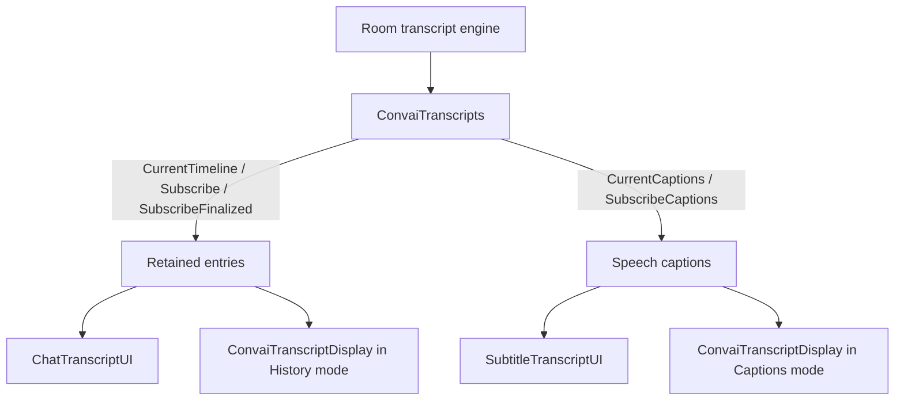

`ConvaiManager.Transcripts` exposes retained conversation history and live speech captions. History supports chat panels, queries, and export. Captions support text shown as a character speaks. Presentation can be disabled without stopping history collection.

## History and captions

The room transcript engine supplies both paths through the `ConvaiTranscripts` facade:

History consists of immutable `TranscriptEntry` values. An entry records a typed submission, a voice contribution, or a character response. A final entry can still receive a correction. Finalization does not prove that audio playback has finished.

Captions follow player recognition and character speech. Timing depends on the available speech signals: a caption can follow server word progress, or be released around speech activity and run ahead of the audio. Do not assume every caption arrives word by word or at the same instant as its history entry.

History is bounded in memory. The default limits are 500 closed entries and 1,000,000 retained UTF-16 text units. Per-entry truncation and open-entry recovery also apply. Read `Transcripts.Health` to detect truncation or eviction; it is not permanent storage.

## Choose a display

<table data-view="cards"><thead><tr><th></th><th data-hidden data-card-target data-type="content-ref"></th></tr></thead><tbody><tr><td><strong>Chat and subtitle modes</strong> Add the shipped chat prefab or the sample subtitle component.</td><td><a href="chat-and-subtitle-modes.md">chat-and-subtitle-modes.md</a></td></tr><tr><td><strong>Per-character transcript display</strong> Show one character's latest entry or caption in a text label.</td><td><a href="per-character-transcript-display.md">per-character-transcript-display.md</a></td></tr><tr><td><strong>Transcript history and queries</strong> Page through entries, subscribe to changes, and export retained history.</td><td><a href="transcript-history-and-queries.md">transcript-history-and-queries.md</a></td></tr></tbody></table>

The chat prefabs are `Prefabs/TranscriptUI/TranscriptUI_Chat.prefab` and `TranscriptUI_Chat_WorldSpace.prefab` in the <code class="expression">space.vars.sdk_package_id</code> package. `SubtitleTranscriptUI` is sample reference code under `SamplesShared/Scripts/UI/Transcript/Subtitle/`; it has no companion prefab.

For Inspector callbacks, add `ConvaiTranscriptEventRelay`. Its **Entry Updated** event includes replayed history; **Entry Finalized** reports finalization, while **Entry Corrected**, **Entry Removed**, and **Reset** handle later changes. These callbacks carry full entry text, not a text delta. The relay forwards while presentation is disabled.

For a character-local spoken sentence callback, use `ConvaiCharacter.OnSpokenLine` (`Action<string>`). It is separate from history subscriptions. See [Transcript API](../../scripting-reference/transcript-api.md).

## Hide presentation without clearing history

The runtime **Transcript** setting controls `IsPresentationEnabled` and `PresentationEnabledChanged`. The shipped chat, subtitle, and character display components honor that setting. History continues to accumulate within its retention limits while they are hidden.

Custom subscriptions keep receiving changes. Your own UI must observe the presentation setting if it should hide with the built-in displays. `ClearHistory()` clears the retained local history and emits a reset; hiding a view does not.

## Next steps


[Migrate transcript integrations](../../scripting-reference/migrate-transcripts-to-5-0.md)

