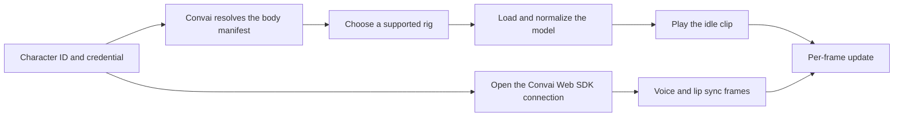
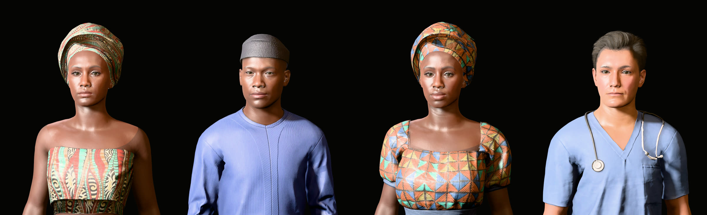

This page explains how Convai Embody gets from a character ID to a body that speaks, and the design choices behind it. For the steps to add a character to a page, see [Add a 3D character to a React app](add-a-3d-character-to-a-react-app.md).

## One credential, one connection

A talking character has two halves: a body to render and a mind that listens and replies. The Convai Web SDK already provides the mind, a `ConvaiClient` that streams the conversation and the character's voice. Convai Embody adds the body and connects the two.

The reason Convai Embody opens the connection itself, instead of asking the app for a client, is that lip sync must come from the same session that produces the voice. Two clients means two sessions: one is heard and the other drives the mouth, so the character either moves its lips to nothing or stays still while it talks. Opening one connection and handing it back as `character.client` removes that failure. It is also why the chat widget is fed through `useWidgetClient` rather than `useConvaiClient`, which would construct a second client.

The connection asks Convai for MetaHuman blendshape frames by default. Without that request Convai sends no lip sync data, and the character would talk with a still face.

The mouth follows the voice as it actually plays, not the clock the frames were sent on. The browser holds and stretches incoming audio to smooth over network jitter, so frames played on a fixed clock drift away from the voice during a reply. Convai Embody reads the playback position of the received audio and shows the frame for that moment, holding through network breaks so the mouth stays in sync after them.

## From character ID to body

Convai resolves a character ID to a body manifest: the model to load, its animation clips, and the rig it was built for. A character's avatar can have its own published web body. When it has none, Convai serves the default body configured for the avatar's gender, or the neutral default for a character with no avatar. When neither exists, the request fails with `Character has no 3D embodiment configured.`

The manifest can offer the same body for several rigs. Convai Embody picks the first rig it understands. The supported rig is `convai-mha-1`, the Unreal Engine MetaHuman rig, and its bone and morph target names are data on a rig profile rather than code, so supporting another rig means adding a profile.

Models are Draco-compressed, so the loader needs the Draco decoder. The model is then scaled to a standing human height and placed with its feet on the floor, and the idle clip starts, so a character is never left in its bind pose.

The body's clips and any clips the app passes in `animations` are loaded by name, and an app's clip replaces the body's clip of the same name. After the idle clip starts, Convai Embody leaves clip changes to the app: speaking moves the mouth, not the body clip, so an app that wants a talking clip switches to it when the client reports that the character is speaking. See [Add your own animations to a character](add-your-own-animations.md).

The manifest normally comes from Convai, but an app can supply its own resolver that returns a manifest for files it hosts. The rest of the flow is the same, because the body still connects to the character's Convai session. See [Use your own 3D model](use-your-own-3d-model.md).

## The frame pipeline

Every frame, the systems that move the character run in a fixed order. The order is part of the design: each system writes to bones or morph targets that a later system reads or overrides.

| Order | System | Why it runs here |
|---|---|---|
| 1 | Gaze restore | Gaze removes last frame's turn from bones the clips will not rewrite, so turns never accumulate. The model's scale is measured once, when it loads. |
| 2 | Animation clips, then grounding | The clips pose the skeleton, then the lowest point of the soles is placed on the floor. |
| 3 | Gaze | Gaze turns the eyes, neck, and torso on top of the pose the clips wrote, so it runs after them. |
| 4 | Breathing | Breathing is added on top of the pose the clips wrote, so it runs after them and never accumulates. |
| 5 | Lip sync, then eye movement, then blinking, then face normals | Blinking runs after lip sync so it controls the eyelid channels that both touch. Last, the surface normals are recomputed where the face's shapes moved it, for models that ship blend-shape positions without normals; otherwise a closed eyelid is lit with its open-eye normals and shades black. |

Gaze follows the camera the way people do. The eyes take small movements, the head follows larger ones, and the torso turns only when the camera stays far to one side. While listening, the character occasionally glances away. Breathing moves the chest before the waist. Blinks vary in timing and completeness, and the eyelids follow downward gaze.

## How the body is shaded

<figure><figcaption>
The same stage, four bodies: skin keeps its tone in shade, hair reads as strands, eyes catch the light, and cloth stays matte.
</figcaption></figure>

The body's materials are re-shaded at load so it responds to your scene's lights the way skin and hair do, whatever the lights are. Skin becomes a physically based dielectric with light wrapping softly past the shadow edge and pore detail; hair draws as coverage, darker toward the scalp, with faint hair-coloured highlights that fade at the silhouette; eyes get a measured iris, a dark pupil and a catchlight; teeth are lit and shaded by the mouth around them. A body whose manifest says `gender: 'male'` gets a male look: lashes at the texture's own alpha, a tighter and less pink skin response with more pore, and a `steady` resting expression. Your lights are never changed; `ConvaiCharacter`'s own canvas adds a portrait rig that follows the camera, and `createPortraitRig` gives a plain three.js scene the same rig. See `surfaces`, `faceMaterials` and `mouth` in the [createCharacter reference](createcharacter-reference.md).

## Lip sync timing

Convai sends mouth frames ahead of the voice, paced for the wall clock; the voice itself is played by WebRTC, which buffers and stretches it. Convai Embody therefore moves the mouth on the voice's own clock, read from the audio track:

- A reply's mouth starts when its voice is first audible, paired with the stream's first mouth movement, so every reply has the same small lead whether it opens on a vowel or on closed lips.
- A pause in the voice holds the mouth; a stall between the voice's chunks (some voices arrive in pieces) does not skip the next chunk's mouth shapes, and frames that arrive after a gap start with their own sound rather than in a burst.
- If the stream runs dry while the voice still plays, the voice level keeps the mouth moving until frames return. The voice never plays on a still face.
- A reply ends with one smooth close.

## Reduced motion

When the user's system requests reduced motion through the `prefers-reduced-motion` media query, Convai Embody damps the additive motion layers, such as breathing, and suppresses glances away and small eye movements. Lip sync and animation clips are not damped, because they carry meaning: a muted mouth would make the character harder to understand without making it calmer to look at.

## Environments

Each release of `@convai/embody` talks to one Convai environment, set by its default `baseUrl`. Character IDs belong to one environment and do not carry over to another. An ID from a different environment fails with a not-found error that reads like a permissions problem but is a wrong-environment problem.

## Related concepts


[Lipsync & Blendshape](../convai-web-sdk/lipsync-and-blendshape/README.md)

