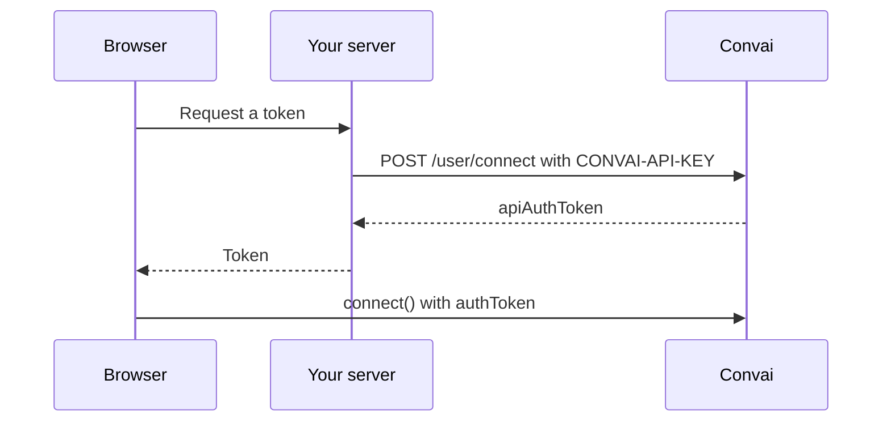

Connect the Convai Web SDK with an auth token minted by your server, so your API key never reaches the browser. Use this page before you publish any page that talks to a character.

## Why use an auth token

An API key is a credential for your whole Convai account. Any value in a client bundle can be read by anyone who opens the page, so a shipped API key can be copied and used outside your application. An auth token is created on your server from the API key, and only the token is sent to the browser.



The diagram shows the API key staying on your server: the browser only ever holds the token.

## Mint a token on your server

Send a `POST` request to `https://api.convai.com/user/connect` with your API key in the `CONVAI-API-KEY` header. The token is in the `apiAuthToken` field of the JSON response.




```typescript
export async function createConvaiToken(): Promise<string> {
  const response = await fetch('https://api.convai.com/user/connect', {
    method: 'POST',
    headers: {
      'CONVAI-API-KEY': process.env.CONVAI_API_KEY!,
      'Content-Type': 'application/json',
    },
    body: JSON.stringify({}),
  });
  if (!response.ok) {
    throw new Error(`Token request failed: ${response.status}`);
  }
  const data = await response.json();
  return data.apiAuthToken;
}
```




```python
import os
import requests

def create_convai_token() -> str:
    response = requests.post(
        "https://api.convai.com/user/connect",
        headers={
            "CONVAI-API-KEY": os.environ["CONVAI_API_KEY"],
            "Content-Type": "application/json",
        },
        json={},
    )
    response.raise_for_status()
    return response.json()["apiAuthToken"]
```



Expose the function through an endpoint of your own that only your signed-in end users can call.

## Connect with the token

Pass `authToken` instead of `apiKey`. Every other option stays the same.



```tsx
import { useConvaiClient, ConvaiWidget } from '@convai/web-sdk/react';

export function Assistant({ token }: { token: string }) {
  const client = useConvaiClient({
    authToken: token,
    characterId: 'YOUR_CHARACTER_ID',
  });

  return <ConvaiWidget convaiClient={client} />;
}
```



```typescript
import { ConvaiClient } from '@convai/web-sdk/core';

const token = await fetch('/api/convai-token').then((r) => r.text());

const client = new ConvaiClient({
  authToken: token,
  characterId: 'YOUR_CHARACTER_ID',
});

await client.connect();
```



The vanilla `createConvaiWidget()` helper also accepts `authToken` in place of `apiKey` when you let it create the client.

Credential rules in `connect()`:

| Configuration | Result |
|---|---|
| `authToken` set | The SDK sends it in the `API-AUTH-TOKEN` header. It takes precedence when `apiKey` is also set. |
| Only `apiKey` set | The SDK sends it in the `X-API-Key` header. |
| Neither set, or no `characterId` | `connect()` throws `Either apiKey or authToken is required, and characterId is required`. |

The long-term memory manager created for the session uses the same credential, so memory calls also work with a token. See [Use long-term memory](long-term-memory.md).


Do not ship an API key in browser code for a public page. Keep `apiKey` for local development and server-side tools.


## Verify the connection

Connect from the page and confirm that `connect()` resolves and the `botReady` event fires. In the browser's network panel, the `/connect` request carries an `API-AUTH-TOKEN` header and no `X-API-Key` header.

## Next steps


[Handle errors and disconnects](error-handling.md)



[Use long-term memory](long-term-memory.md)



[Configuration and type reference](vanilla-typescript/best-practices-and-type-definitions.md)

