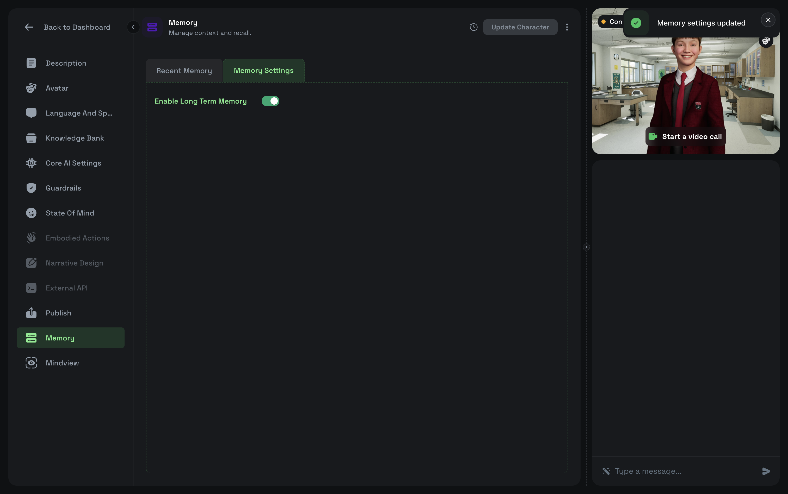

Let a character remember an end user across sessions by connecting with a stable end-user ID, then read or change that user's memories through the memory manager. Use this page when you identify your users and want the character to recall them, or when your application needs to seed or prune what it remembers.

## Prerequisites

- The Convai Web SDK installed and a working connection. See [Web SDK quickstart](quickstart.md).
- A Convai API key or auth token, and a character ID from <code class="expression">space.vars.dashboard_url</code>.
- Long-term memory enabled on the character in the Convai dashboard: open the character, select the **Memory** tab, and turn on long-term memory under **Memory Settings**.

<figure><figcaption></figcaption></figure>

## Connect with an end-user ID

Pass `endUserId` in the configuration. Any non-empty string is accepted. Use a value that identifies the same person in every session, such as a UUID or an email address. Without `endUserId` the session is anonymous and has no memory manager.



```tsx
import { useConvaiClient } from '@convai/web-sdk/react';

const client = useConvaiClient({
  apiKey: 'YOUR_API_KEY',
  characterId: 'YOUR_CHARACTER_ID',
  endUserId: 'a1b2c3d4-5678-90ab-cdef-1234567890ab',
});
```



```typescript
import { ConvaiClient } from '@convai/web-sdk/core';

const client = new ConvaiClient({
  apiKey: 'YOUR_API_KEY',
  characterId: 'YOUR_CHARACTER_ID',
  endUserId: 'a1b2c3d4-5678-90ab-cdef-1234567890ab',
});
```



After `connect()` resolves, `client.state.endUserId` holds the end-user ID that Convai returned, which can differ from the one you passed.

## Get the memory manager

`client.memoryManager` is a `MemoryManager` instance or `null`. The SDK creates it during `connect()` only when Convai returns an end-user ID for the session and the client holds an `apiKey` or an `authToken`. It uses the same credential as the connection. The SDK sets it back to `null` on disconnect.

```typescript
const memory = client.memoryManager;

if (!memory) {
  // Not connected, or the session has no end-user ID.
  throw new Error('Connect with an endUserId before using memories');
}
```

Every method is scoped to the character ID and end-user ID of the session.

## List memories

`listMemories()` takes an optional `{ page, pageSize }` object and returns one page of memories.

```typescript
const result = await memory.listMemories({ page: 1, pageSize: 50 });

console.log(`Total: ${result.total_count}, more pages: ${result.has_more}`);
for (const m of result.memories) {
  console.log(m.id, m.memory, m.created_at, m.updated_at);
}
```

| Option | Type | Default | Range |
|---|---|---|---|
| `page` | `number` | `1` | Clamped to `1`–`1000` |
| `pageSize` | `number` | `50` | Clamped to `1`–`100` |

The response is a `MemoryListResponse` with `memories`, `total_count`, `page`, `page_size`, and `has_more`. Each `Memory` has `id`, `memory`, `created_at`, and `updated_at`; the timestamps are ISO strings.

## Add memories

`addMemories()` takes an array of strings. It throws `Memories array is required and must not be empty` when the array is empty.

```typescript
const added = await memory.addMemories([
  'Completed the forklift safety module.',
  'Prefers instructions in short steps.',
]);

for (const m of added.memories) {
  console.log(`Added ${m.id}: ${m.memory}`);
}
```

Each returned entry has `id`, `event` (always `"ADD"`), and `memory`.

## Read or delete one memory

`getMemory()` returns a single `Memory`. `deleteMemory()` returns `{ message, memory_id, deleted }`. Both throw `Memory ID is required` when the ID is empty.

```typescript
const m = await memory.getMemory('f4cbdb08-7062-4f3e-8eb2-9f5c80dfe64c');
console.log(m.memory);

const result = await memory.deleteMemory(m.id);
if (result.deleted) {
  console.log('Deleted', result.memory_id);
}
```

## Delete all memories for the end user

`deleteAllMemories()` removes every memory for the current character and end-user pair. Deletion is asynchronous on Convai, so the response confirms the request rather than the result.

```typescript
const result = await memory.deleteAllMemories();
console.log(result.message, result.character_id, result.end_user_id);
```


Deletion cannot be undone. List the memories again later to confirm that they are gone before telling the end user.


## Use the memory manager without a session

Import `MemoryManager` from `@convai/web-sdk/core` to manage memories without connecting, for example in an administration tool.

```typescript
import { MemoryManager } from '@convai/web-sdk/core';

const manager = new MemoryManager(
  'YOUR_API_KEY',
  'YOUR_CHARACTER_ID',
  'a1b2c3d4-5678-90ab-cdef-1234567890ab',
);

const page = await manager.listMemories();
```

The constructor signature is `new MemoryManager(apiKeyOrAuthToken, characterId, endUserId, baseUrl?, useAuthToken?)`:

| Parameter | Type | Default | Description |
|---|---|---|---|
| `apiKeyOrAuthToken` | `string` | none | API key, or auth token when `useAuthToken` is `true`. |
| `characterId` | `string` | none | Character the memories belong to. |
| `endUserId` | `string` | none | End user the memories belong to. |
| `baseUrl` | `string` | `'https://api.convai.com'` | Memory API origin. A trailing slash is removed. |
| `useAuthToken` | `boolean` | `false` | Send the credential as `API-AUTH-TOKEN` instead of `CONVAI-API-KEY`. |

The constructor throws `API key or auth token is required`, `Character ID is required`, or `End user ID is required` when an argument is empty. To switch scope on an existing instance, call `setEndUserId()` or `setCharacterId()`; read the current values with `getEndUserId()` and `getCharacterId()`.

## Troubleshooting

### The memory manager is null

**Symptom:** `client.memoryManager` is `null` after connecting.

**Cause:** The configuration has no `endUserId`, `connect()` has not resolved yet, or the client has disconnected.

**Fix:** Pass `endUserId`, and read `client.memoryManager` after `connect()` resolves.

**Verify:** `client.state.endUserId` is a string and `client.memoryManager` is not `null`.

### A memory call rejects

**Symptom:** A `MemoryManager` method rejects with an `Error`.

**Cause:** Convai rejected the request. The error message is the `ERROR` field of the response, or `HTTP error! status: <code>` when the response has none.

**Fix:** Check the credential, the character ID, and the memory ID in the message.

**Verify:** `listMemories()` resolves with the expected `total_count`.

## Next steps


[Connect with an auth token](auth-tokens.md)



[ConvaiClient reference](vanilla-typescript/convaiclient-core-api.md)



[Configuration and type reference](vanilla-typescript/best-practices-and-type-definitions.md)

